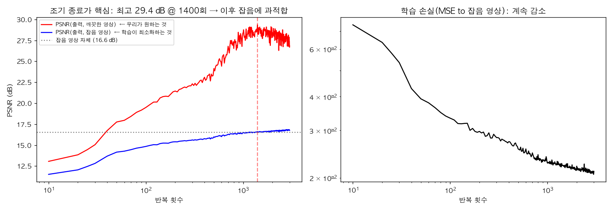
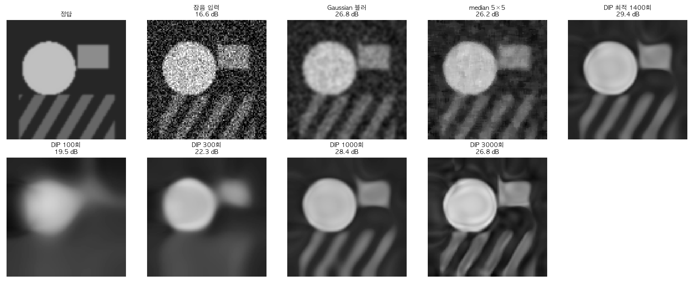

# picz-deep-image-priors

> **Deep Image Prior (DIP)**: 학습 데이터 없이, 무작위로 초기화한 CNN 하나를 잡음 낀 *한 장의* 영상에 맞추기만 해도 잡음이 제거된다. 네트워크의 **구조 자체가 영상의 사전 지식(prior)** 이기 때문이다.

## 🎬 영상

[](https://youtu.be/Fb5mR6qEhIk)

**데이터 없이 잡음을 제거한다? 딥 이미지 프라이어의 비밀** — https://youtu.be/Fb5mR6qEhIk
(해시태그: #딥 #이미지 #프라이어 #Prior #DIP)

> ⚠️ 영상 본문(자막·설명)은 읽지 못했고 확인된 것은 제목과 해시태그뿐입니다. 아래는 제목이 가리키는 Deep Image Prior(Ulyanov, Vedaldi, Lempitsky, CVPR 2018)의 일반 원리와, 이 저장소의 `dip_demo.py`(PyTorch)로 직접 실행한 장난감 실험으로 구성했습니다. 영상의 구체적 전개·예시와 다를 수 있습니다.

## 1. 아이디어

일반적 잡음 제거 네트워크는 (잡음 영상, 깨끗한 영상) 쌍으로 학습합니다. DIP 는 다릅니다.

- 입력: 고정된 무작위 텐서 z (학습 대상 아님)
- 네트워크 f_θ: **학습되지 않은** 합성곱 CNN
- 최적화: `min_θ ‖ f_θ(z) − y_noisy ‖²` — 이 한 장의 잡음 영상에만 맞춤
- 결과: 반복 중간에 멈추면(**조기 종료**) f_θ(z) 는 잡음이 제거된 영상에 가깝다

왜 될까: CNN 은 구조적으로 (합성곱·다운/업샘플링의 가중치 공유 때문에) **매끈하고 반복적인 구조를 불규칙한 잡음보다 훨씬 빨리** 만들어 냅니다(저주파 우선 학습 = spectral bias). 잡음은 마지막에, 오래 걸려서야 맞춰집니다. 그러므로 "자연스러운 영상이 되기 전까지"만 학습하면 잡음은 아직 안 따라온 상태입니다.

## 2. 실험 설정 (`dip_demo.py`)

- 96×96 합성 영상(원, 사각형, 줄무늬), 가우시안 잡음 σ=0.15 → 잡음 영상 PSNR 16.56 dB.
- 네트워크: 스킵 연결 없는 4단 hourglass(stride-2 합성곱 4번 → 양선형 업샘플 + 합성곱 4번, 채널 64, BatchNorm, LeakyReLU), 입력 z = 32채널 균일 무작위(0~0.1) + 매 반복 작은 가우시안 섭동(σ=0.03).
- Adam, lr=0.01, 3000회. CPU 에서 약 138초. 시드 1개.
- 비교 기준: Gaussian 블러(σ=1.2, 튜닝하지 않은 값 하나), 5×5 median.

## 3. 결과



- **파랑**(학습이 줄이는 것, 출력 vs 잡음 영상의 PSNR)은 계속 오르고 **손실도 계속 감소**합니다.
- **빨강**(우리가 원하는 것, 출력 vs 깨끗한 영상의 PSNR)은 오르다가 **1400회에서 최고 29.36 dB** 를 찍고 이후 잡음에 과적합되며 3000회에서 26.83 dB 로 떨어집니다. 즉 **훈련 손실만 보면 멈출 곳을 알 수 없습니다.**



| 방법 | PSNR (dB) |
|---|---|
| 잡음 입력 | 16.56 |
| Gaussian 블러 (σ=1.2) | 26.78 |
| median 5×5 | 26.20 |
| DIP 100회 | 19.5 |
| DIP 300회 | 22.3 |
| DIP 1000회 | 28.4 |
| **DIP 최적 (1400회)** | **29.36** |
| DIP 3000회 (과적합) | 26.83 |

- 100회: 아주 흐릿한 덩어리만(저주파) → 300회: 큰 형체 → 1000회: 줄무늬·모서리까지 나타남 → 3000회: 잡음 흔적(원 안의 물결 무늬, 배경 얼룩)이 생김.

### 저주파 먼저 학습된다 (spectral bias)

정답 대비 주파수 대역별 상대 오차 ‖출력−정답‖/‖정답‖(0이면 완벽):

| 반복 | 저주파 (r<0.1) | 중주파 (0.1~0.25) | 고주파 (0.25~0.8) |
|---|---|---|---|
| 100 | 0.259 | 0.994 | 0.997 |
| 300 | 0.178 | 0.849 | 0.961 |
| 3000 | 0.093 | 0.633 | 0.846 |

저주파가 가장 먼저, 고주파는 훨씬 나중에 맞춰집니다. 또한 (출력−정답) 과 (잡음) 의 상관계수가 100회 0.018 → 1000회 0.096 → 3000회 0.231 로 커져, 학습이 길어질수록 출력이 잡음을 따라가는 것을 수치로 볼 수 있습니다.

## 4. 한계와 주의 (중요)

- **오라클 조기 종료**: 위 최적 1400회/29.36 dB 는 깨끗한 영상을 보고 최고점을 고른 것입니다. 실제로는 정답이 없으므로 멈출 시점을 따로 정해야 합니다(원 논문은 고정 반복 수 사용, 후속 연구는 분산 기반 정지 기준 등). 오라클이 아닌 고정 횟수 1000회에서는 28.4 dB, 3000회에서는 Gaussian 블러(26.78)와 거의 같은 26.83 dB 입니다.
- 이 합성 영상(매끈한 큰 영역 위주)은 DIP 의 구조적 prior 에 유리합니다. Gaussian 블러는 σ 하나만 시험했고 최적화하지 않았습니다. **단일 영상·단일 시드·단일 잡음 수준의 결과이므로 일반적 순위로 해석하면 안 됩니다.**
- 줄무늬·모서리의 경계는 DIP 출력에서 번져 있습니다(해상도는 낮음). 학습된 최신 잡음 제거 네트워크나 BM3D 와의 비교는 하지 않았습니다.
- 영상마다 수천 회 최적화가 필요해 **느립니다**(여기서도 96×96 한 장에 약 2분 이상).

## 5. 응용·확장 (일반론)
- 잡음 제거, 초해상도, 인페인팅(마스크 밖 영역만 맞추기), JPEG 아티팩트 제거, 의료·천문 영상처럼 학습 데이터가 없거나 적은 영역.
- 확장: 구조 선택에 따른 prior 변화(스킵 연결을 쓰면 잡음도 빨리 맞춤), 조기 종료 기준 자동화, 정규화(TV 등)와 결합.

## 6. 재현
```bash
pip install numpy scipy matplotlib torch
python dip_demo.py   # figures/*.png 생성, 표 수치 출력 (CPU 약 2~3분)
```
(그림 갤러리의 빈 칸은 후처리로 흰색으로 가렸고, 스크립트는 이후 같은 효과가 나도록 수정되어 있습니다.)

## 참고
- Ulyanov, Vedaldi, Lempitsky, *Deep Image Prior*, CVPR 2018 (IJCV 2020 확장판)
- Rahaman et al., *On the Spectral Bias of Neural Networks*, ICML 2019
